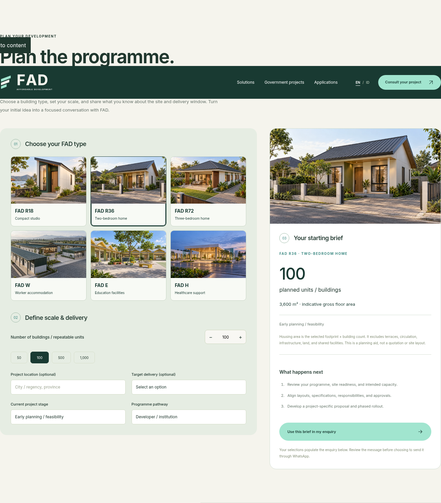
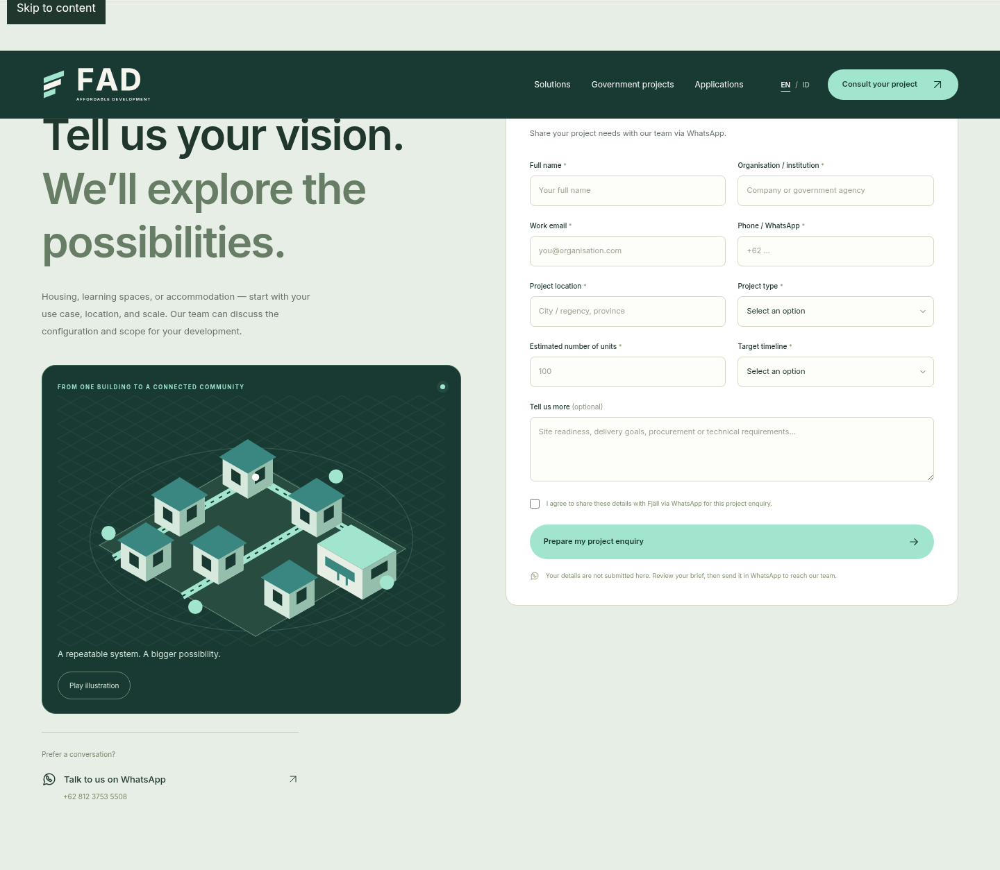
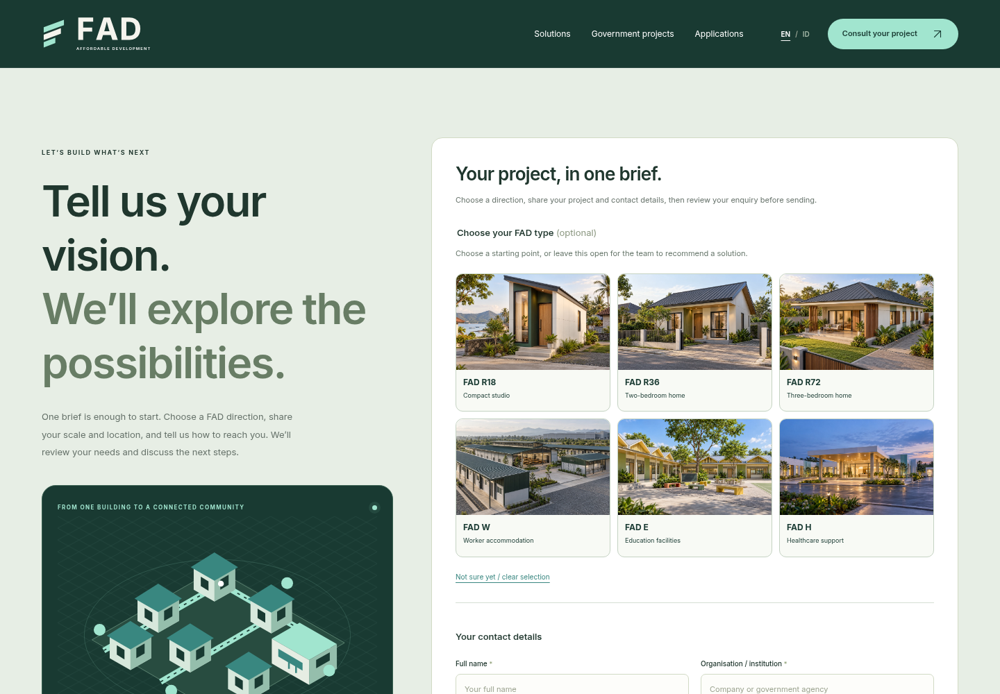
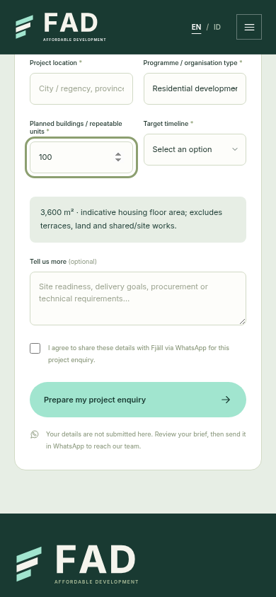

# Enquiry flow review and rework

The standalone planner and “Let’s build what’s next” both collected quantity, location, and timeline. The planner then copied them into the contact form, creating a second pass over the same brief. They are now one general enquiry surface.

1. **Choose a direction — streamlined.** The six optional FAD choices now sit inside the contact form. Product-page CTAs select the relevant choice. Visitors can clear it or leave it open for a recommendation.
2. **Enter project and contact details — consolidated.** General location, quantity, and timeline each have one input. Housing area is displayed beside project details, using the entered quantity; facility capacity remains subject to review. Existing notes are preserved instead of being filled with repeated product-selection lines.
3. **Review and hand off — retained and verified.** A single form validates its required fields and consent, then opens the existing review dialog. The selected FAD type appears once as a structured brief field. Nothing is sent automatically. Government procurement enquiries retain their separate specialised form.

## Evidence

### Before: planner

### Before: contact form

### After: one enquiry surface

### After: project details on mobile

## Findings and verification limits

The former planner gave a helpful visual starting point but added repeated entry and a handoff that visitors needed to verify. The contact form had clear labels and an explicit WhatsApp review step; those were retained. The rework removes the duplicate inputs and keeps selection metadata separate from visitor notes.

The optional design choices use native buttons and pressed states. Required inputs use native validation, and the area preview has a polite live region. Browser checks cover bilingual input preservation, form validation, selected-design handoff, native quantity limits, and layouts from 320 to 1440 pixels. No screen-reader session or real WhatsApp send was performed; screenshots alone cannot establish full accessibility compliance. Evidence is from the local repository version captured during this review, with checks against both source and `/FAD/` build paths. Plugin browser-support resources were unavailable, so capture used the existing Playwright/Chromium workflow.
